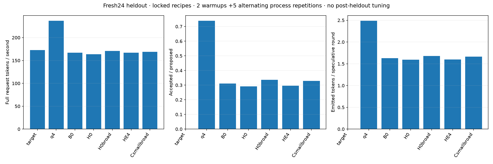
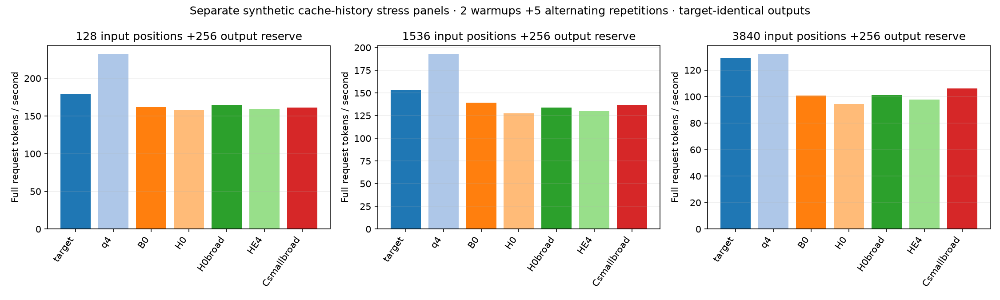
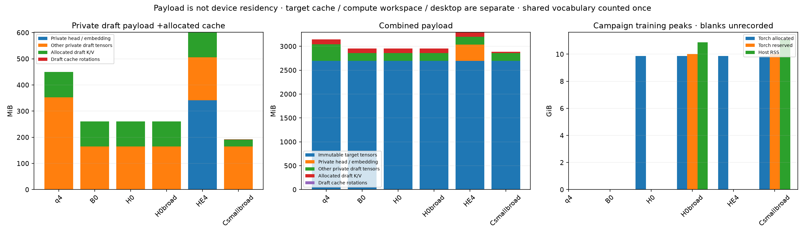
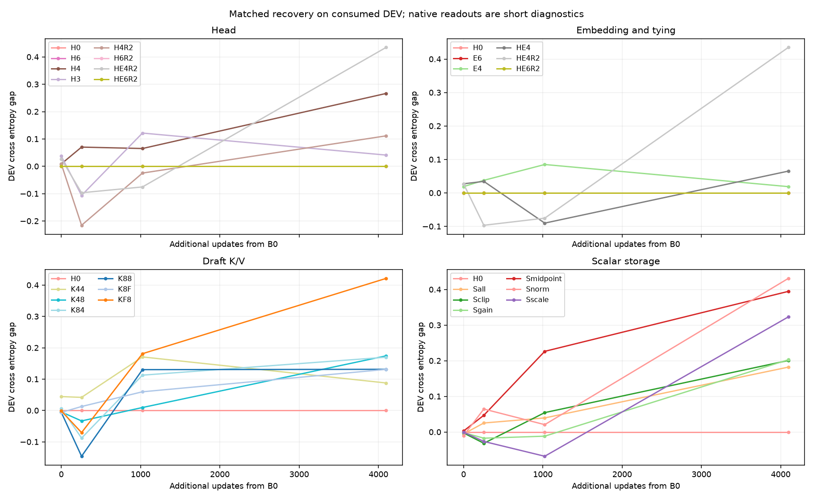
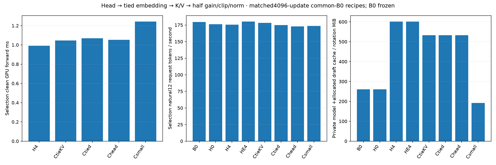

# Remaining component precision: completed comparison

Completed November 6, 2026, on the local RTX 5080 with the modern Qwen3.5-4B Q4_K_M target. All authorized primary recovery, targeted rescue, combinations, broader-data confirmation, retained-state qualification and formal panels are complete. No deployment promotion over external DFlash Q4_K_M is supported.

HE4 is the retained faster-head endpoint. Csmallbroad is the retained smaller-cache endpoint. Both have full masters/Adam/RNG/cursor checkpoints that re-export the exact evaluated native files and actually resume on the GPU.

## Formal results

Fresh 24 heldout clusters, prepared only after the shortlist/config/native-weight lock: two same-process warmups and five alternating measured repetitions. Each model has 120 measured requests; greedy repeats share the same 24 inputs. Counts below are actual measured totals. Request throughput includes prompt processing; model loading is outside the request.

| Model / role | Request tok/s | Request / external Q4 [paired 95%] | Accepted / proposed | Clean draft GPU ms | Private model + 4,096 draft-cache/rotation MiB |
|---|---:|---|---:|---:|---:|
| Target-only | 172.86 | 0.730 [0.708, 0.755] | — | — | — |
| External DFlash Q4_K_M | 236.67 | 1.000 [1.000, 1.000] | 16,525/22,365 | 1.1789 | 449.35 |
| Frozen learned-small2048 B0 | 166.90 | 0.705 [0.690, 0.723] | 10,595/34,150 | 1.1700 | 260.50 |
| Matched original-data continuation | 163.44 | 0.691 [0.672, 0.710] | 10,190/34,945 | 1.1694 | 260.50 |
| Matched broader-data continuation | 170.95 | 0.722 [0.704, 0.742] | 11,125/33,110 | 1.1681 | 260.50 |
| HE4: tied private Q4_K vocabulary | 167.06 | 0.706 [0.690, 0.724] | 10,280/34,765 | 0.9954 | 601.51 |
| Csmallbroad: Q4 K/V +half gain/clip/norm | 168.95 | 0.714 [0.696, 0.734] | 10,965/33,400 | 1.2399 | 191.76 |

HE4 reduces clean GPU forward time by 14.88% against equally trained H0 (latency ratio 0.8512, paired 95% 0.8474–0.8548). Complete generation draft-host cost is 1.970 ms/round versus 2.170 ms for H0. Heldout request speed improves 2.21% against H0 (paired 95% 1.17–3.28%), but reaches only 70.59% of external Q4. Attribute this improvement to the declared private Q4 vocabulary path; the common binary FFN recipe is unchanged.

Csmallbroad lowers private-model plus allocated draft-cache/rotation payload from 260.50 MiB to 191.76 MiB, approximately 68.74 MiB saved against H0broad. Native cache allocation is 96.00→27.00 MiB, with 0.47 MiB rotation buffers charged and 216,064 fewer private scalar-tensor bytes. Its request ratio to H0broad is 0.9883 (paired 95% 0.9758–1.0022), so that timing interval still includes a tie. It reaches 71.39% of external Q4 request speed.

HE4 contains one 357,580,800-byte private vocabulary tensor (341.02 MiB), physically shared by draft head and embedding. The immutable target vocabulary remains present. HE4 therefore adds memory versus target-sharing H0; private Q4 is smaller than the exact private-Q6 control, which adds 521,472,000 bytes. Private vocabulary and combined deployment costs stay distinct.

All formal outputs, content and stopping semantics match target-only. Full packet validation covers 1,680 measured native requests and 420 excluded warmups across six separate panels, plus clean GPU replay, trace invariance, actual formats and retained-state/native identity. Intervals resample complete prompt/process cells; they do not establish training-seed uncertainty.

## Context and memory behavior

The following are separate synthetic cache-history stress panels built from already-consumed token IDs, with a full 256-token output reserve and five measured repetitions. They exercise sequential growth, rejection/rollback and near-capacity operation; natural heldout quality is reported above. No contexts are pooled.

| Input positions | Target-only tok/s | External Q4 | H0broad | HE4 | Csmallbroad | Csmallbroad / H0broad [paired 95%] |
|---|---:|---:|---:|---:|---:|---|
| 128 | 178.99 | 231.86 | 164.85 | 159.42 | 161.10 | 0.977 [0.970, 0.986] |
| 1536 | 153.65 | 192.59 | 133.80 | 129.86 | 136.68 | 1.022 [1.019, 1.026] |
| 3840 | 129.07 | 131.94 | 101.20 | 97.93 | 106.21 | 1.049 [1.031, 1.066] |

The cache tradeoff changes with context: the compact recipe is slower in the short synthetic panel, and faster than its own matched control in the medium and near-limit panels. External Q4 remains faster in every tested context.

Tensor payload is not total resident memory. Native GPU model-buffer totals, mapped CPU buffers, cache/rotation allocation, compute-buffer history, host RSS and sampled combined device peaks are separately retained. Allocation logs have 0.01 MiB display rounding. The common target contributes 2,824,005,632 tensor bytes. Combined target+private-model+draft-cache payload is approximately 3,454.74 MB for HE4,3,025.08 MB for Csmallbroad, and 3,295.18 MB for external Q4 (decimal MB); target caches, graph workspace, device copies and desktop usage remain separate. No checkpoint compression ratio is used as inference memory.

## Full campaign coverage

Every qualified initial primary arm received cumulative 0/256/1,024/4,096readouts. All four R2 arms and all four combinations received their full 4,096-update windows. H6/E6 use authenticated identical-forward H0 training reuse, with separate actual native copy/placement evaluations and zero extra optimizer updates.

| Stage | Physical4096 windows | Actual scope and outcome |
|---|---:|---|
| Primary head / embedding |5| H0,H4,H3,E4,HE4; exact private-Q6 H6/E6 copy controls reuse H0. Tied Q4 is one native CUDA allocation. Finite Q3 probe completed; its selection GPU cost did not justify a deeper compact-head sweep. |
| Draft K/V |6| Q8/F16,F16/Q8,Q8/Q8,Q4/Q8,Q8/Q4,Q4/Q4. Real write/read formats, K128/V64 Hadamard order, native cache allocations and gradients qualified. |
| Scalar storage |6| Isolated row scale, midpoint, positive gain, clip, norm and supported all-scalar F16 storage, with F32 math/reductions. Scale/midpoint save251,904 bytes each but add conversion cost in selection; useful combinations restore these groups to F32. |
| Targeted R2 |4| Head-only and tied Q4 variants plus matched private-Q6 controls. All 2,483,200 existing native block-scale magnitudes are trainable; codes/subscales remain frozen. Larger natural DEV did not support promotion under this recipe/budget. |
| Original-history combinations |4| Csmall=K44+half gain/clip/norm; Chead=H4+K44 with F32scalars; CtieKV=HE4+K44; Ctied=HE4+K44+half gain/clip/norm. Each trains directly from B0 with matched order/exposure. |
| Broader-data matched pair |2|16 new native TRAIN captures, then H0broad/Csmallbroad, each 4,096 updates with the same new manifest, seed/order and cursor0. |
| Frontier-state regeneration |1| HE4 original optimizer state had retired under the bounded rolling policy. One same-history regeneration matches all four original native exports exactly. Csmallbroad original full state was reused directly. |
| Total |28|114,688 physical recovery/regeneration updates; two separately counted actual resume-qualification updates bring actual optimizer work to 114,690. |

R1 is upstream compensation through the selected quantized head/embedding/cache/scalars, with vocabulary masters frozen. R2 is bounded native block-scale QAT, not dense head/embedding-master QAT. A measured10.60 GB R1 Torch allocation plus an estimated7.63 GB of dense vocabulary gradient/Adam storage exceeds this16 GiB device budget before desktop/driver costs; dense-master training was not attempted. The actual R2 pilot peaked at 11.99 GB allocated. These are decimal GB.

All arms remain in the full ledger and component charts, including recovering or stalled outcomes. A completed 4,096window is not a convergence or permanent irrecoverability claim. R2 residual dense-loss gaps and actual native acceptance disagree in some cases, so dense loss is not used as an acceptance substitute. No architecture, objective, capacity correction layer or vocabulary shortlist was added.

## Frozen method, ancestry and cost

B0 is the exact learned-small2048 optimized G4/D8 checkpoint: W1 all 18 FFN projections, A4 gate/up and A8 down inputs, learned clipping, affine row scales/midpoints, shared positive gate/up gains, separate down gain and existing norms. Fusion/attention remain Q4_0. Baseline draft vocabulary is target-shared Q6_K and draft KV is F16. Target Qwen3.5-4B Q4_K_M, target F16 KV, verifier, tokenizer/vocabulary IDs, greedy depth 2 and `GGML_CUDA_DECODE_CONSISTENT=32` remain unchanged. Every final control/finalist uses qualified runtime04.

Original recovery repeats24 native TRAIN captures:1,426 overlapping windows and 1,762 unique supervised label positions. The separate broader recipe contains 40 sequences,3,234 overlapping windows and 3,794 unique label positions. Each 4,096-update arm consumes61,440 supervised positions; these are repeated exposure, not61,440 fresh labels. Original and broader results retain different manifest/order histories. All 192 admitted TRAIN groups and prior consumed/opaque cohorts were excluded before fresh 24selection. The cohort is now consumed for this fixed comparison; no post-heldout tuning occurred.

Actual recovery/regeneration update compute is 17,937.79 seconds (4.98 hours). Measured checkpoint saving/verification totals 4,543.82 seconds (75.73minutes), separately accounted. Setup, exports, captures, native evaluations, profiling, restart downtime and report work are additional. Recovery-versus-update-compute and actually recorded trainer-wall charts are both published. Unrecorded historical intermediate wall times remain null.

Both retained-state producer runs measured10,597,126,656Torch allocated bytes and 10,756,292,608reserved bytes. Csmallbroad producer host peak RSS is 11,882,254,336 bytes; HE4 regeneration host peak RSS is 10,883,846,144 bytes. Original older HE4 reserved/RSS fields were unrecorded and remain blank; the retained-state producer measurements are separately identified in compact results. These are training process/allocator measurements, distinct from native sampled runtime peaks.

Elapsed wall from the first supervised component pilot to the final benchmark supervisor release was 13.53 hours, including the three WSL interruptions, setup/archival/evaluation and intervening time. Final report generation follows that interval; it is not inferred from update throughput.

## Native qualification and limits

The final full-vocabulary head audit covers 27 arm/domain cases,54 required columns and 248,320 logits per column, including all four R2 arms. All 54 argmax decisions match the exact packed-weight F32 reference; worst absolute error0.024294and RMS0.004520bound native activation/reduction drift. Full HF/native graph parity remains unresolved.

Actual cached write/read fixtures qualify Q8_0/Q4_0/Q5_0 grouping and K128/V64rotation order; selected cache formats are verified in each native allocation. Scalar import/half-clip reader proofs and final native tensor/data-address audits prove physical storage/tying, rather than relying on GGUF flags or CLI acceptance. Paired plain/instrumented native traces preserve proposal/prefix counts.

Each retained state was fully decoded and checked for masters, Adam history, RNG and exact cursor/order/exposure. It re-exported the exact evaluated native bytes, restored exact GPU masters/moments and deployment-rounded values, then executed the saved next TRAIN update with Adam4096→4097and finite changed masters. Those two qualification updates are separately accounted and did not change retained4096states or finalist weights. Full archive hashes were re-read after formal evaluation.

## Results and preservation

[Compact machine-readable results](results.json) include all 31 reference/arm endpoints, source/data/parent identities, trainability/precision maps, actual quality/cost/memory and retained-state producer measurements. The complete raw artifact root is `/home/philip/binary-eagle-decoding/runs/component-campaign-20261105-01`.

- [Full 118-readout interactive comparison](/home/philip/binary-eagle-decoding/runs/component-campaign-20261105-01/charts/comparison.html) and [focused finalist interactive chart](/home/philip/binary-eagle-decoding/runs/component-campaign-20261105-01/charts/finalists.html).
- [Full JSON](/home/philip/binary-eagle-decoding/runs/component-campaign-20261105-01/charts/comparison.json), [full CSV](/home/philip/binary-eagle-decoding/runs/component-campaign-20261105-01/charts/full-table.csv), [all separate panels JSON](/home/philip/binary-eagle-decoding/runs/component-campaign-20261105-01/charts/all-panels.json) and [all panels CSV](/home/philip/binary-eagle-decoding/runs/component-campaign-20261105-01/charts/all-panels.csv).
- [Chart/publication manifest:20 PNG +20 SVG](/home/philip/binary-eagle-decoding/runs/component-campaign-20261105-01/final-publication.json), including loss/rank/margin/agreement recovery, actual wall/compute, prefix survival, request/GPU/host tradeoffs, combined/shared/private memory and training peaks.
- [Formal packet validation](/home/philip/binary-eagle-decoding/runs/component-campaign-20261105-01/qualification/final-protocol.json), [actual full-state/native/GPU resume proof](/home/philip/binary-eagle-decoding/runs/component-campaign-20261105-01/qualification/frontier-recovery/result.json), [physical allocation proof](/home/philip/binary-eagle-decoding/runs/component-campaign-20261105-01/qualification/final-physical-allocation/verified.json) and [actual CUDA format dispatch](/home/philip/binary-eagle-decoding/runs/component-campaign-20261105-01/format-profiles/dispatch.json).
- [Final recipe lock](/home/philip/binary-eagle-decoding/runs/component-campaign-20261105-01/final-recipe-decision.json), [pre-heldout exact native/runtime lock](/home/philip/binary-eagle-decoding/runs/component-campaign-20261105-01/final-selection.json), [heldout exclusion/consumption audit](/home/philip/binary-eagle-decoding/runs/component-campaign-20261105-01/heldout24/audit.json), [data/cost accounting](/home/philip/binary-eagle-decoding/runs/component-campaign-20261105-01/accounting.json) and [environment/clock/power snapshot](/home/philip/binary-eagle-decoding/runs/component-campaign-20261105-01/final-environment.json).

The two full retained frontier states are `/mnt/c/binary-eagle-component-20261105-01/Csmallbroad-4096.pt.bsz` and `/mnt/c/binary-eagle-component-20261105-01/HE4-confirm-4096.pt.bsz`, with exact receipts and native identity in [frontier retention](/home/philip/binary-eagle-decoding/runs/component-campaign-20261105-01/frontier-retention.json). The full B0 parent, target/external references, dictionary bases, native exports, source archives, all TRAIN captures and raw measurements remain protected. Prior explicitly authorized exploratory-state retirement is intentional and was not reversed. Damaged earlier reboot-history metadata and the fixed manifest-reference failure are preserved in their audit receipts.

Only authenticated NEW rolling predecessors and verified owned scratch were retired under the existing campaign policy. Archive hashes/location records do not claim an independent backup. Compact source/findings/figures are committed locally; weights, captures and raw runs stay outside Git. Parent owns canonical STATUS, review/integration and the delayed shader-thread message. No push or external message was performed.

[Completed preservation inventory and owned-GPU release proof](/home/philip/binary-eagle-decoding/runs/component-campaign-20261105-01/milestone-retention-and-release.json). The two retained archive files passed fresh final hash reads; every supervisor created by this continuation is terminal and its group is absent.
