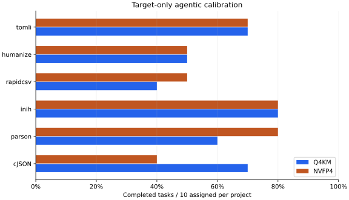

# Agentic curation and provenance

The final revision is frozen. The [result](result.md) distinguishes calibration
from fresh reference measurements and describes the retained artifacts.

## Target-only calibration

The completed calibration combines unchanged tasks with fresh target-only runs
of the eight corrected Python follow-ups. Revision four reached 35/60 on Q4KM;
its first 57 rows were followed by three recovery tasks after a binary-workspace
harness failure. NVFP4 revision four stopped after its unchanged first 52 tasks
(32 completions), avoiding the obsolete Python-runner hint. Revision five's
changed tasks complete 4/8 on Q4KM and 5/8 on NVFP4. All prior evidence remains.
Initial contexts span 11,523–19,865 tokens, averaging 16,304; each format stops ten
exact-repeat loops during calibration.

The first pilot completed 0/3 terminal tasks before an operator stop; an in-progress
fourth task has no terminal result. The second pilot completed 0/6 target tasks.
Revision two moved the task after project context and added bounded navigation;
revision three added concise test instructions. Revision four retained membership
but replaced compiler plumbing with native test scaffolds and bug-fix follow-ups
with a second independent library behavior. Revision five removes a misplaced
compiler-oriented subprocess hint from eight Python follow-ups and explicitly
requests direct imports and top-level assertions. Its changes use target transcripts,
not drafter scores. Four Baseline tasks ran in the second pilot before the lead
requested target-only calibration; no HE4 candidate task ran in those pilots.

## Repository and content checks

| Project | Role | Language | License | Earliest reachable first commit |
| --- | --- | --- | --- | --- |
| DaveGamble/cJSON | DEV, 10 tasks | C | MIT | 2009-08-26 |
| kgabis/parson | DEV, 10 tasks | C | MIT | 2012-10-16 |
| benhoyt/inih | DEV, 10 tasks | C/C++ | BSD-3-Clause | 2009-07-10 |
| d99kris/rapidcsv | DEV, 10 tasks | C++ | BSD-3-Clause | 2017-05-19 |
| python-humanize/humanize | DEV, 10 tasks | Python | MIT | 2011-10-07 |
| hukkin/tomli | DEV, 10 tasks | Python | MIT | 2021-05-23 |
| mahmoud/boltons | Confirmation, 15 tasks | Python | BSD-3-Clause | 2013-02-19 |

Pinned revisions, full root-commit identities and license receipts are in the
[definition](../../benchmarks/definitions/agentic-coding-v1.json). The small native
projects permit executable C/C++ checks without downloading a build ecosystem
inside the sandbox. All chosen projects predate the conservative 2023-12-01
source cutoff: the date test supplies no exclusion proof for these projects.

The mechanical repository check resolves all 640 + 615 TRAIN session tasks and
750 bank CommitPack rows back to the full raw source. The current-name lookup
spans 46,412 aliases. A deeper reachable-commit audit identifies `jmoiron/humanize`
and three Boltons forks in unused raw rows; transitive alias-family expansion
still finds **zero selected TRAIN family or commit matches**. This corrects the
initial overly broad raw-source claim: the raw source contains related history,
while the admitted TRAIN selections are disjoint under these recorded identities.
The 6,000-row TRAIN bank contains 750 CommitPack rows, not 6,000
CommitPack rows. All 750 selected Magicoder rows authenticate to the retained
stripped seed hashes and exact prompt bodies. The content scan compares upstream
Python/C/C++ code, including tests, against those seeds, problems and answers,
all 6,000 TRAIN bank requests and the 750 CommitPack rows' old/new source files.
Whitespace-insensitive 13-token shingles require at least twelve shared shingles
and 35% containment in the smaller set; raw exact-content matches require at
least 25 tokens. There are no hits at either threshold.

Magicoder lacks repository identities. Clean seed/content scans do not prove
repository ancestry, semantic independence or absence of target pretraining
exposure. Non-code documentation and license boilerplate are outside the code
scan. The first-commit dates, name exclusions, seed authentication and content
scan are separate checks; none is presented as a stronger provenance guarantee
than it supplies. No protected evaluation corpus was used.

The full audit receipts remain unchanged under
`/home/philip/BitDraft/artifacts/benchmarks/agentic-coding-01/provenance/`.
`repository-lineage-audit.json` corrects the initial current-name-only audit;
`audit-fullbank.json` owns the code scan and `seed-authentication.json` owns the
selected Magicoder seed authentication. `calibration-v5-plan.json` records all
eight before/after prompt revisions, and `calibration-v5-outcome.json` records
the complete target-only outcome mapping.
