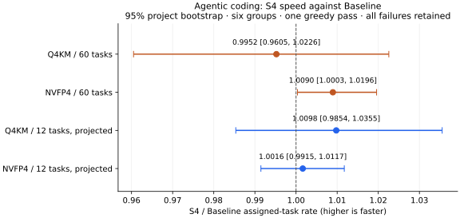

# Six-project agentic suite qualifies with exact speculative outputs

The new suite measures sixty DEV tasks across six permissive C, C++ and Python
projects, with a fixed twelve-task slice. Both target formats complete 37/60
(61.7%). Baseline and S4 exactly match their target-only responses, stopping,
workspace fingerprints and completion on all 240 drafter tasks. Fifteen additional
Boltons tasks remain frozen and unexecuted for confirmation.

## Outcome

One fresh greedy pass per arm and format; failures remain in every denominator.
Intervals resample six whole project groups with 2,000 paired bootstrap draws.
They describe task/project sampling, not repeated-run timing noise.

| Format / panel | Completed, every arm | Acceptance: Baseline / S4 | S4 / Baseline task rate, 95% interval |
| --- | ---: | ---: | ---: |
| Q4KM / slice | 5/12 | 61.78% / 64.39% | 1.0098 [0.9854, 1.0355]× |
| Q4KM / suite | 37/60 | 63.40% / 66.28% | 0.9952 [0.9605, 1.0226]× |
| NVFP4 / slice | 7/12 | 69.34% / 68.93% | 1.0016 [0.9915, 1.0117]× |
| NVFP4 / suite | 37/60 | 68.83% / 69.93% | 1.0090 [1.0003, 1.0196]× |

Q4KM remains unresolved against Baseline. NVFP4 shows a small 0.90% measured
lead, with a project interval narrowly above parity (lower bound 1.00035); this
interval cannot quantify run-to-run timing noise or establish a robust speed gain.



[All three-arm standings and intervals](tables.md) include target-relative speed,
acceptance intervals, paired acceptance differences and completed/failed strata
for both panels. [Target-relative speed](speed.svg), [acceptance](acceptance.svg) and [compact measurements](result.json)
retain the same evidence. The preselected slice has lower completion than the full
suite; it was not retuned after calibration scores or drafter results.

| Format / suite outcome | Tasks | Seconds/task: target / Baseline / S4 | Acceptance: Baseline / S4 |
| --- | ---: | ---: | ---: |
| Q4KM / completed | 37 | 10.33 / 7.84 / 7.77 | 65.10% / 68.39% |
| Q4KM / failed | 23 | 14.09 / 10.56 / 10.78 | 61.52% / 63.97% |
| NVFP4 / completed | 37 | 11.05 / 7.82 / 7.78 | 71.04% / 71.49% |
| NVFP4 / failed | 23 | 15.83 / 11.03 / 10.89 | 66.52% / 68.28% |

Exact consecutive assistant repeats stop as failures. Detection-call tokens,
counters and time are excluded from primary acceptance and task-rate totals;
raw transcripts and physical costs retain them. Each full arm stops ten loops.
Task rate is assigned tasks divided by their summed primary wall time, including
tools. Completed and failed strata use their own task counts and summed times.

| Format / arm | Full suite measured arm, min | Slice projected raw task cost, min |
| --- | ---: | ---: |
| Q4KM / Target-only | 12.30 | 2.64 |
| Q4KM / Baseline | 9.28 | 2.02 |
| Q4KM / S4 final | 9.34 | 2.00 |
| NVFP4 / Target-only | 13.17 | 3.03 |
| NVFP4 / Baseline | 9.29 | 2.10 |
| NVFP4 / S4 final | 9.22 | 2.09 |

Full-arm costs include load, warmup and bookkeeping, but exclude shared panel
preflight. Slice costs are projected
from the twelve selected tasks in valid full evidence, include loop detection,
and exclude an independent load/warmup; no standalone slice run was measured.
[Detailed costs](tables.md) separate full raw task time, warmup and remaining
overhead. Startup alone was not instrumented. Pilots, calibration and both full
panels consumed **97.45 controller-to-release minutes**, modestly above the
approximate ninety-minute allocation. No extra GPU repeats or slice runs were made.

## Scope and limitations

The suite has 44 seeded bug fixes, eight test-writing tasks, four features and
four refactors, each with a checked follow-up. Test-writing checks require the
submitted test to detect a protected faulty implementation. All 240 DEV
broken/repaired initial/follow-up controls pass. Relevant source gives initial
contexts of 11,523–19,865 tokens, mean 16,304. Each instruction style appears twenty
times; the slice fixes two styles per project. Styles vary across different tasks,
so their causal effect is not identified. At most sixteen assistant calls,
with 1,024 output tokens each, exercise focused authored library maintenance,
not observed production traffic or hours-long issue resolution.

| Calibration revision | Target-only outcome | Change |
| --- | --- | --- |
| 1 | Q4KM 0/3 terminal; fourth task interrupted | Initial pilot |
| 2 | No model execution | Put request after source; bounded navigation |
| 3 | Q4KM 0/6 | Concise test/compiler guidance |
| 4 | Q4KM 35/60 across 57 + 3 recovery rows; NVFP4 32/52 prefix | Native test scaffolds; independent behavior follow-ups |
| 5, frozen | Q4KM 37/60; NVFP4 37/60 | Correct eight Python follow-up runner hints; checks/membership unchanged |

[Calibration and provenance](curation.md) records project dates, every revision,
source identities and the before/after interpretation. Calibration used target-only
outcomes; four Baseline pilot tasks preceded that policy, and no S4 pilot task ran.
The final full target passes reproduce every calibrated task's completion.

Repository-family and reachable-commit checks exclude all selected TRAIN sessions
(640 + 615 tasks) and 750 CommitPack bank rows. Historical Humanize and Boltons
aliases occur in unused raw source, so full raw-source disjointness is not claimed.
All 750 Magicoder seeds authenticate; code scans against their seeds/answers,
all 6,000 bank requests and selected CommitPack old/new files find no exact or
13-token shingle hits at the documented thresholds. Every project predates the
source-date cutoff. Magicoder's missing repository identities, unrecorded ancestry,
semantic overlap and target pretraining remain explicit provenance limits. No
protected evaluation data was accessed or used.

The early Baseline INI pilot diverged after a random GCC object filename appeared
in tool output. The harness now normalizes only that temporary path and retains
raw logs. A later target task created binary bytecode and exposed a text-only
fingerprint failure; agentic fingerprints now hash file bytes and suppress child
Python bytecode. Original failures remain retained. Final panels have zero
trajectory divergences; native draft counts independently reconcile with logs.

## Decision

Retain the qualified suite, frozen slice, three-arm references and unexecuted
reserve. Existing screen, broader120, prefix18 and live12 definitions and references
remain unchanged. The new style variation supplements the prefix cohort; retirement
was not part of this change. A close S4/Baseline speed comparison needs fresh matched
repeats and the reserved one-time confirmation before a stronger speed claim.
No faster decision rule or other agent's scenario panels were implemented here.

## Evidence and reproduction

The [definition](../../benchmarks/definitions/agentic-coding-v1.json) pins project
revisions, licenses, roles, recipes, workload and audits. All large evidence lives
under `/home/philip/BitDraft/artifacts/benchmarks/agentic-coding-01/`:

- `runs/{q4km,nvfp4}-suite-v5/`: complete panels, transcripts, workspace states,
  native logs, commands and reaped-server receipts.
- `candidate-specs/{q4km,nvfp4}-v5-agentic-{slice,suite}.json`: candidate-only
  specifications with saved target, Baseline and S4 prior-leader references.
- `registrations/`: twelve new records established with `record-reference` in
  `/home/philip/BitDraft/artifacts/benchmarks/references`; no record overwritten.
- `provenance/*-raw-verification.json`: independent reconstruction of all 360
  fingerprints and primary counters, first-repeat checks and log reconciliation.
- `provenance/`, `prepared-calibration-v5/`, `panels-calibration-v5/`: audits,
  all controls, frozen tasks and calibration history. Confirmation uses
  `panels-confirmation-v4c/` and its access receipt: zero model/check executions.

Executed source identity is
`a2da8d5b269c5b6d8bdb73c34ab35f131ddff1fa5dd18c07babb948dcfac6e2b`,
retained under `executed-sources/`, independently of the report commit. The RTX
5080 ran Qwen3.5-4B Q4KM/NVFP4, runtime-v7 protocol v3, exact verification, depth
three, F16 KV, 32,768 context and `--cache-ram 0`. Baseline is the repository's
DFlash **Q4KM** artifact `83586a63…`; the brief's full-precision label does not
describe this control. S4 is final export `405e326b8c6ba7a54da7fc7d5d5436f5d45284be4bb980d0062d4c7d9a104dd9`.
Specifications retain full runtime, library and model hashes. Sandbox Python
3.14.4, GCC/G++ 15.2.0 and bubblewrap 0.11.1 are recorded in `toolchain-v5.json`;
the full OS/compiler dependency closure is not vendored.

Use maintained `prepare-project-workflows`, `prepare-panels`, `prepare-checks`,
`live` and `record-reference`. Worktree execution uses the frozen source under
main artifacts to preserve existing storage resolution. Figure regeneration:

```sh
/home/philip/BitDraft/artifacts/benchmarks/agentic-coding-01/figure-env/bin/python /home/philip/BitDraft/artifacts/benchmarks/agentic-coding-01/specs/render_result.py results/agentic-coding-suite
```

`q4km-tasks.json` and `nvfp4-tasks.json` retain compact per-task measurements;
`result.json` binds those files and retains summary inputs, source references and the
figure/extraction script identities. The locked check environment can be rebuilt
from the frozen `uv.lock`; launch receipts name the worktree environment used. Regenerating charts is separate from rerunning
models. The full CPU commit gate passes 127 tests and 92 rule proofs.

## Artifact disposition

Retain project snapshots and authenticated recipes as replay inputs; provenance,
calibration revisions and stopped-pilot evidence explain admission and repairs.
Retain full valid panels, raw task workspaces, frozen source and native logs as
the reusable references' dependency closure. Keep the unexecuted reserve and its
access history, and the small pinned figure environment/scripts for regeneration.
No training/model artifact or other worker's output was modified or retired;
no exact replay was deliberately discarded. The artifact root occupies about **1.24 GiB**, plus **51.50 MiB** of new
registry records, recorded in `allocation-cost.json`; this remains below fifteen GB.
