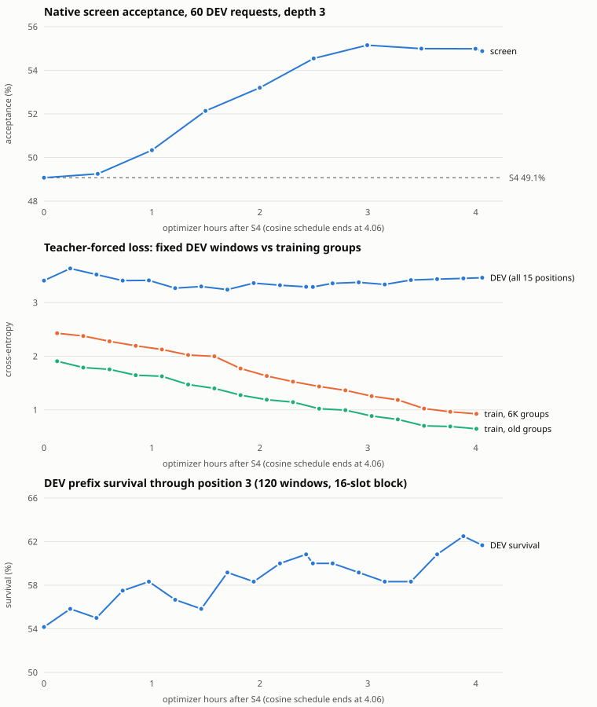

# Continuing S4 for four optimizer-hours adds 5–6 acceptance points; gains stop near two data passes while training loss keeps falling

S4 was trained for about 30 optimizer-minutes, a third of one pass over the 6K corpus, and
its schedule decayed to zero. This run continued it for about four more optimizer-hours on
the 6K corpus plus 6,000 new natural prompts from the original 15,647-record corpus. A native
screen every 30 optimizer-minutes and DEV diagnostics every 4,300 updates trace the learning
curve, and the loss of every training update separates the two data components.

Screen acceptance rose from S4's 49.1% to 55.2% at three optimizer-hours (1.85 passes of
the mixture), then stayed flat to the end (54.9%). On the 120-request Q4KM panel the final
state accepts 5.2 points more than S4 and closes about 44% of S4's gap to Baseline
(12.0 → 6.8 points). Training loss kept falling throughout, and loss on a group seen for the
second time is about 0.6–0.75 lower than on its first visit, while the DEV metrics that
matter moved a few points. The drafter is increasingly fitting its training data rather than
generalizing. The flattening also coincides with the step size reaching the cosine tail,
so this run alone cannot say whether more passes at a useful step size would still pay.

## Outcome

The chart's data are in [result.json](result.json) (`screens`, `dev`, `train_loss_bins`).
Screen: the 60-request Q4KM DEV screen, depth 3, protocol v3 (runtime-v6) saved controls.
Differences to S4 are paired source-group bootstraps (2,000 draws) against S4's saved
screen. Labels and passes count only this continuation; S4 itself trained on 2,458,062
labels, about 0.36 passes of the 6K corpus.

| Optimizer hours | New updates | Labels (M) | Mixture passes | Step multiplier | Screen acceptance | Accepted per round | Change from previous | vs S4 (95%) |
| ---: | ---: | ---: | ---: | ---: | ---: | ---: | ---: | --- |
| 0 (S4) | 0 | 0 | 0 | — | 49.07% | 1.454 | | |
| 0.50 | 8,839 | 2.70 | 0.31 | 0.97 | 49.25% | 1.459 | +0.18 | +0.2 (−0.9, +1.2) |
| 1.00 | 17,708 | 5.41 | 0.62 | 0.87 | 50.34% | 1.491 | +1.09 | +1.3 (+0.2, +2.4) |
| 1.50 | 26,568 | 8.12 | 0.92 | 0.72 | 52.14% | 1.541 | +1.80 | +3.1 (+1.9, +4.1) |
| 2.00 | 35,420 | 10.83 | 1.23 | 0.53 | 53.20% | 1.575 | +1.07 | +4.1 (+2.9, +5.3) |
| 2.50 | 44,228 | 13.52 | 1.54 | 0.34 | 54.55% | 1.614 | +1.34 | +5.5 (+4.5, +6.5) |
| 2.99 | 53,098 | 16.23 | 1.85 | 0.17 | **55.15%** | 1.634 | +0.61 | +6.1 (+5.0, +7.1) |
| 3.50 | 61,974 | 18.95 | 2.15 | 0.05 | 55.00% | 1.629 | −0.16 | +5.9 (+4.8, +7.1) |
| 4.00 | 70,842 | 21.65 | 2.46 | 0.00 | 54.99% | 1.630 | −0.01 | +5.9 (+4.8, +7.1) |
| 4.06 (final) | 72,000 | 22.00 | 2.50 | 0 | 54.88% | 1.627 | −0.11 | +5.8 (+4.7, +7.0) |

Both components were consumed at the same rate: at the end 2.50 passes of the 6K windows and
2.50 of the old ones. "Step multiplier" is the cosine factor on every step size at that
update. Each screen's sampling noise is about ±1 point, so single half-hour changes are rough.

**Where gains flatten.** Gains ran at 2–3.6 points per optimizer-hour from 1 to 2.5 hours,
fell to 1.2 per hour between 2.5 and 3 hours, and were below zero after 3 hours. In this run
every hour after the first three adds less than 0.5 points; the point is at about 53,000
updates, 16 million labels and 1.85 mixture passes. The last hour ran with a step multiplier
below 0.17, so it measures the end of the schedule as much as the data.

**The 120-request Q4KM panel** (one pass, saved protocol-v3 controls):

| Arm | Acceptance | Accepted per round | Tokens/s | vs target-only | vs Baseline speed | Acceptance vs S4 (95%) | Acceptance vs Baseline (95%) |
| --- | ---: | ---: | ---: | ---: | ---: | --- | --- |
| S4 (saved) | 41.39% | 1.241 | 222.6 | 1.27× | 0.89 | | −12.0 (−12.6, −11.2) |
| 3-hour state | 46.24% | 1.386 | 235.2 | 1.35× | 0.94 | +4.9 (+4.4, +5.4) | −7.1 (−7.8, −6.2) |
| Final state | 46.59% | 1.397 | 235.5 | 1.35× | 0.94 | +5.2 (+4.7, +5.8) | −6.8 (−7.5, −5.9) |

Baseline accepts 53.3% at 250.1 tokens/s. The final state leads the 3-hour state by 0.35
points (+0.09, +0.61), so on longer answers the low-step final hour still added a little.
Speed ratios against saved controls are descriptive, not paired timing.

**Train/DEV gap.** Training loss is the per-update loss over positions 1–3 (4-slot blocks),
averaged in bins of 4,300 updates. Passes repeat the same group order, so a group seen in
pass 2 can be compared with its own first visit.

| Optimizer hours (bin middle) | 6K training loss | Old training loss | 6K: same group vs previous pass | Old: same group vs previous pass | DEV loss, 15 positions | DEV top-1, positions 1 / 2 / 3 | DEV survival through 3 |
| ---: | ---: | ---: | ---: | ---: | ---: | --- | ---: |
| 0.1 | 2.43 | 1.91 | first visit | first visit | 3.41 (start) | 84 / 74 / 65 | 54.2% |
| 1.0 | 2.12 | 1.63 | first visit | first visit | 3.41 | 87 / 75 / 67 | 58.3% |
| 1.6 | 2.00 | 1.40 | −0.41 | −0.51 | 3.24 (lowest, 1.7 h) | | |
| 2.0 | 1.63 | 1.19 | −0.71 | −0.59 | 3.36 | 87 / 75 / 68 | 58.3% |
| 3.0 | 1.26 | 0.89 | −0.75 | −0.58 | 3.38 | 88 / 79 / 64 | 59.2% |
| 4.0 | 0.93 | 0.65 | −0.60 | −0.47 | 3.46 (end) | 89 / 78 / 69 | 61.7% |

During the first pass both components' loss on unseen groups fell (6K 2.43 → 2.00, old
1.91 → 1.40), so the new prompts taught something general. From the second pass on, training
loss fell by more than half again while DEV moved little: DEV loss over all fifteen
positions bottomed at 1.7 hours and ended above its start, and first-three-position top-1
and survival rose by 4–8 points with noise of about ±4 (120 windows). The all-position
DEV loss includes positions 4–15 that a 4-slot drafter never trains, so its rise is a weak
signal; the positions it does train improve slowly, the training data much faster.

**Old corpus against 6K-only.** Gains were broad: every screen category rose 3–8 points at
three hours and at the end. At three hours inputs under 512 tokens gained most (+8.0,
against +2.6 to +6.4 for longer bands; at the end the three longest requests led with +8.2),
which fits the short old prompts but does not prove they caused it ([result.json](result.json) holds the per-request rows).
There is no 6K-only continuation to compare against: S4's own curve ends at 8,209 decayed
updates and predicts nothing beyond them. Whether the 6,000 old prompts helped or hurt is
therefore not established by this run.

Throughput: 0.203 optimizer-seconds per update (about 1,500 labels/s within updates), with
data waits adding 8%; peak allocation 13.5 GB. Screen pauses took 64–72 s against the 120 s
budget.

## Scope and limitations

- One run, one seed, one schedule, one GPU; DEV screen and panel are reused DEV cohorts.
- **The cosine confound.** The run used one cosine over its planned length, so each mid-run
  screen was measured at a higher step size than a run planned to stop there would end with.
  Mid-run points understate what that much training achieves, and the flattening after
  3 hours coincides with the step multiplier dropping below 0.17. A settle-down branch
  (a few minutes decaying to zero) from each kept mid-run state would give the annealed
  curve; the full states at 1 and 2 hours (and 3 hours and final) are kept for that.
- The old component was selected from natural records only: 2,208 old records duplicate 6K
  prompts and 5,658 are templated authored prompts (fixed wording, varying numbers), so both
  were excluded. The 6,000 chosen are short (mean prompt 143 tokens against the 6K's 625) and
  cover only code, reasoning and prose. Their prior exposure in the 220,095-update lineage
  does not apply to S4's lineage, which starts from the DFlash initialization.
- Data and training length are not separated: no 6K-only continuation and no mixture at a
  different size were run.
- DEV loss and top-1 use one 16-slot block of 120 windows, not the 4-slot blocks S4 serves
  and trains with; the screen sees only answer openings. Training loss bins mix groups of
  different difficulty, but the same-group comparison is exact.
- Runtime-v7 became the benchmark runtime on main during this run; it gives identical request
  outputs and draft counts to runtime-v6, so these v6 screens and panels stay comparable.

## Decision

Decided within this run's scope: no deployment or leader promotion, and S4 remains the
saved prior leader for protocol-v3 references until the owner decides otherwise. The final
state is the best measured S4-lineage drafter on the panel.

Proposed, not decided:

- Plan about two passes of the available data per run (here about 3 optimizer-hours, 53,000
  4-slot updates on 12,000 prompts) with the cosine sized to that length. Beyond two passes
  the drafter mostly memorizes, so spend further GPU time on new distinct prompts first.
- Measure the annealed curve with settle-down branches from the kept 1-hour and 2-hour
  states, and run a 6K-only continuation of the same length to separate data from time.
- The journal-rotation pause bug found here is fixed on this branch: a rotation is no longer
  counted against the 120 s check budget ([benchmarks](../../docs/benchmarks.md)).

## Evidence and reproduction

- Executed source: identity `f88948bd…` (branch commit `2dce22af`, which adds per-update losses
  to progress records), frozen in `artifacts/training/s4-data-curve-01/executed-sources/` of
  the main checkout and run with `--frozen` there.
- Start: S4 state `6977443f…` (8,209 updates), export `10ade33a…`, saved screen reference
  `35150f3e…`. Recipe `c59b855e…`: continue mode, 4-slot blocks, decay weights, row latent
  scale ×3 with clamp, sign step 4e-3, warm-up 1,440 updates from update 8,209, cosine to
  zero at 80,209; seed 8101; screens every 1,800 optimizer-seconds; DEV every 4,300 updates.
- Data: mixture `34a955a8…` of the 6K FP16 corpus `3fbc0135…` (2,283,089 windows) and an
  index-intent over a 6,000-row subset of the original index `d703d61f…` (653,302 windows;
  rows copied unchanged). Selection, exclusion reasons and make-up per record are in
  `artifacts/datasets/s4-data-curve-mixture-01/selection.json`; arrays were read in place.
- Execution: the first campaign (`campaign/`) ran 52,437 updates. When the journal filled,
  the worker rotated (142 s, mostly model reload), and the campaign's post-screen check
  counted that rotation as an over-budget screen pause and stopped after the 2.5-hour screen.
  `campaign-resume/` resumed the exact state at update 52,437 with the same source, recipe,
  cursor and Adam/RNG state, reusing the 2.5-hour screen as its initial reference. An earlier
  launch was refused before allocation by the declared disk capacity (`refused-attempt-01/`).
- GPU: 20:38–01:39 on 2026-11-13/14, 5.0 hours of wall time under the project lease,
  including model loads, screens, the rotation and the two panels (403 s); 4.06 optimizer-hours.
- Panels: `q4km-requests-leader.json` of runtime-v6-depth3 with the candidate swapped.
- `artifacts/training/s4-data-curve-01/scripts/` holds every script: `select_old.py`
  (selection and mixture), `make_campaign.py`, `make_resume.py`, `launch.py`, the GPU-idle
  watcher, `health.py`, `panel_specs.py`, `panels.sh`, `verify_load.py`, `verify_all.sh`,
  `retire.py`, `build_result.py` (regenerates result.json from the journals, screens and
  panels) and `make_chart.py` (regenerates chart.svg from result.json:
  `python3 make_chart.py result.json chart.svg`).

## Artifact disposition

Retained in `artifacts/training/s4-data-curve-01/` of the main checkout (22 GB):

- Full states with Adam/RNG and their exports: final `769e184e…` / `405e326b…` (80,209
  updates), 3-hour `98bc20f8…` / `496ace42…` (61,307), 2-hour `5c372c1a…` / `1a31f2c4…`
  (43,629) and 1-hour `45203729…` / `7900a4df…` (25,917). The mid-run states are kept for
  settle-down branches. All four restore in branch mode with main's code at `0d2e4b88` and
  re-export byte-identically to their kept exports (`logs/verify-*.json`); continue mode needs
  CUDA and was not exercised.
- The 2.5-hour provisional leader's export `5b01d776…` and its campaign reference; its state
  is retired.
- All journals, intents, specifications, screens, panels, logs, the refused attempt and the
  campaign reference registry; the frozen source; the mixture folder in
  `artifacts/datasets/s4-data-curve-mixture-01/` (selection, subset index and intent, mixture).

Retired through `Store.retire_closed`, with receipts naming the final state as recovery:
states at updates 17,048 (0.5 h), 34,777 (1.5 h), 52,329 (rotation), 52,437 (2.5 h), 70,183
(3.5 h) and 79,051 (4 h); exports at 34,777, 52,329, 70,183 and 79,051 (the 0.5-hour export
was pruned by the run's own retention). Exact resume from those points is no longer
available. The original corpus, the 6K corpus, S4's folder and the saved controls were read
only.
